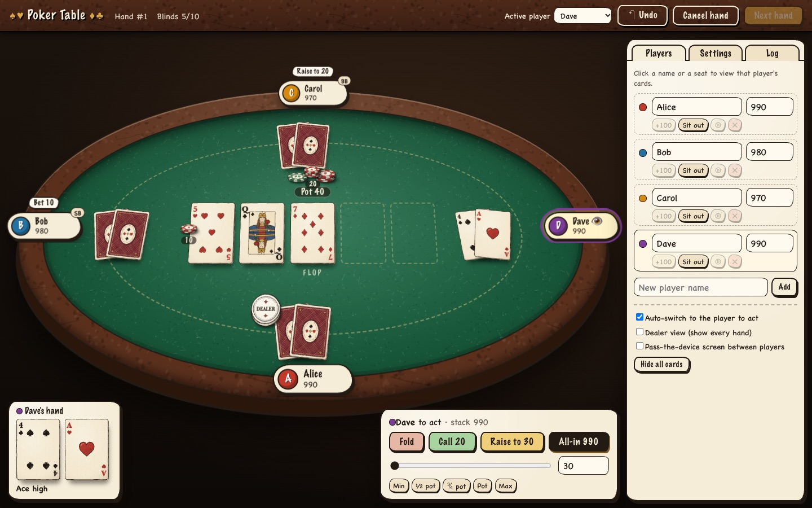

# Poker Training System

A hand-drawn, 3D-style **No-Limit Texas Hold'em table** for playing by hand on one screen.
It runs as a **macOS desktop app** (Electron) and in **any browser** (Vite build).
Every action can be entered by hand, or any seat can be handed to a **bot**. The engine
handles blinds, turn order, min-raises, side pots, showdown and chip counts.



## Features

- **Active player switching.** Click a seat or a name, or use the *Active player* menu, to see that
  player's own hole cards. Every other hand stays face-down. Optional modes:
  - *Auto-switch* follows whoever is to act.
  - *Dealer view* shows every hand.
  - *Pass-the-device* covers the screen between players.
- **Live chip counting.** Each player's stack, the bets in front of them and the pot are drawn as real
  chip stacks (1 / 5 / 25 / 100 / 500 / 1000). Chips **persist across hands and restarts** until you
  press **Settings → Reset all chips**.
- **Full rules.**
  - Blinds and antes, the heads-up blind order, and the BB option.
  - Min-raise; short all-ins don't reopen the betting.
  - Uncalled-bet refunds and automatic run-outs.
  - Side pots with odd-chip handling, and a best-five-of-seven evaluator.
- **Manual control.** Add, remove or rename players, edit stacks between hands, sit out, move the
  button, cancel a hand (everything refunded), and **undo** (⌘Z).

## Bots and the simulator

- **Play against bots.** The welcome screen (and *Bots → New game against bots*) seats you against
  one or more bots heads-up, 3-handed or 6-max and deals straight away. Your result shows in the top
  bar; busted bots rebuy automatically and you get a *Rebuy* button.
- **Bots at the table.** In the *Bots* tab, set any player to a bot. Bots act on their own turn at
  *Slow / Normal / Fast / Instant* speed, can auto-deal hands, and can be paused (e.g. to undo).
- **Simulator screen** (*📊 Simulator* in the top bar). Pick two bots, a format (3v3, 3v3 blocks,
  heads-up, 2v2, 1v5), a number of decks, duplicate on/off, workers and an optional seed. Matches run
  headlessly across Web Workers with a live estimate, then a results dashboard shows the winner and
  95% range, decisions per second against the 10,000/s requirement, the winnings curve (showdown vs
  non-showdown), how the estimate converged, profit by position, action mix by street and a
  side-by-side stats table. The last 12 runs are kept, and reports link to *Play vs …* for available bots.
- **CLI.** `npm run sim -- --a opus --b gpt` runs the same match from the terminal on every core.
  Use `--hands`, `--seats a,b,c`, `--workers 1` (one continuous session, so bots can adapt across the
  whole match), `--bench <bot>` and `--list`.

The simulator uses its own fast hand engine (`src/sim/table.ts`) and 5–7-card evaluator
(`src/sim/eval.ts`, ~10 ns per hand). Tests replay random hands through both engines to check the
rules match the table engine. With stacks reset every hand, a 6-max match runs at about 600,000
hands/s on 16 cores with the simple built-in bots. A real bot's thinking time sets the actual pace.

### Included bots

Both were built from the research in `docs/research/bots/`, in separate worktrees, and decide in
roughly 10–25 µs (40,000–100,000 decisions/s).

- **Opus 5.5** (`src/bots/agents/opus`, by Claude Opus 5.5). Tracks a weighted range for every
  opponent, narrowing it with each action according to that player's learned tendencies. It runs a
  Monte Carlo equity estimate against those ranges, sizes bets by expected value using each
  opponent's fold rate at that size, and mixes between close options. Preflop it uses solver-style
  charts adjusted to opponents. `opus-static` (no learning) and `opus-b` are experiment variants.
- **GPT 6.2 Sol** (`src/bots/agents/gpt`, by GPT 6.2 Sol). Mixed six-max preflop ranges, a
  precomputed short-stack blind-vs-blind policy, range narrowing with card-removal (blocker)
  effects postflop, and opponent modelling that weights recent hands more.

Opus vs GPT, 3v3 at 6-max, 50,000 duplicate decks (100,000 hands):

| Run | Opus bb/100 |
|---|---|
| 16 workers, three seeds | +35.5, +36.8, +37.7 (each ± ~3.5) |
| One continuous session (bots adapt across all hands) | +63.9 ± 3.8 |

### Writing a bot

Implement `BotSpec` from `src/bots/types.ts` (`decide(view)` returns fold, check, call, raise-to or
all-in, and the optional `handEnd(summary)` reports each finished hand for opponent modelling).
Baseline bots for tests and benchmarks live in `src/bots/builtin.ts`. Playable bots live in
`src/bots/agents/` and are registered in `src/bots/registry.ts`. Bots should decide in
well under 100 µs (10,000 decisions/s). The simulator reports anything slower.

## Run it

```bash
npm install
npm run dev            # browser: http://localhost:5173
npm run electron:dev   # desktop app with hot reload
npm run electron       # build, then open the desktop app
npm run dist:mac       # package a .dmg/.zip into release/ (fetches electron-builder via npx)
npm test               # engine tests
npm run sim -- --help  # bot-vs-bot simulator
```

Keyboard: **N** deals the next hand, **⌘Z / Ctrl+Z** undoes.

## Layout

| Path | What |
| --- | --- |
| `src/engine/` | Pure TypeScript rules engine (reducer, evaluator, pots, shuffle). No UI. |
| `src/bots/` | Bot API, registry, built-in bots and the live-table adapter. `local/` holds private bots (git-ignored). |
| `src/sim/` | Fast headless hand engine, evaluator, match runner, CLI and arena worker. |
| `src/art/` | Deterministic hand-inked SVG art (cards, chips, stacks, dealer button, textures), served as cached data-URL sprites. |
| `src/ui/` | React table, seats, action bar and side panel. |
| `src/store.ts` | App state, undo history and localStorage persistence. |
| `electron/` | Desktop shell. |
| `docs/research/` | Rules and performance research the engine is based on; `bots/` covers bot architecture, fast evaluation and strategy. |
| `design-samples/` | The blind art-direction bake-off and its council review. |
